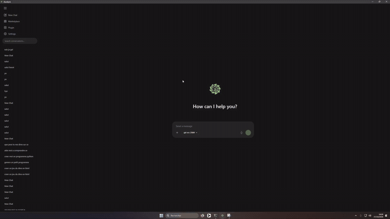

# Auralyne

  

<h3 align="center">Your local AI coding assistant for embedded development.</h3>

  Build, debug, and develop Arduino and ESP32 projects with AI — running locally on your own hardware.

  <a href="#features">Features</a> •
  <a href="#demo">Demo</a> •
  <a href="#technology">Technology</a> •
  <a href="#roadmap">Roadmap</a>

---

## What is Auralyne?

Auralyne is a local-first AI development environment designed to make embedded programming easier.

It combines AI-assisted coding with a development workflow tailored to microcontrollers and electronics projects. The goal is to help you go from an idea to working firmware while keeping control over your projects and AI models.

Whether you're working with Arduino, ESP32, or other supported boards, Auralyne aims to bring coding, debugging, and project assistance into one place.

## Demo

  

## Features

- **AI coding agent** — Get help writing, modifying, and understanding code.
- **Local AI inference** — Run compatible GGUF models locally through `llama.cpp`.
- **Embedded development** — Designed around Arduino, ESP32, and microcontroller projects.
- **Project-aware assistance** — Work with your project's files and existing code.
- **Debugging assistance** — Investigate errors and improve your implementation.
- **Library and pin guidance** — Get help with libraries, board pins, and hardware integration.
- **Wiring assistance** — A foundation for connecting firmware and electronics workflows.
- **Model configuration** — Configure supported models and inference settings.
- **Privacy-oriented design** — Local inference helps keep your code and prompts on your machine when using local models.

*Features and hardware support are under active development.*

## Technology

| Component | Technology |
|---|---|
| Desktop application | Tauri |
| Frontend | React |
| Build tooling | Vite |
| Backend | Rust |
| Local AI inference | `llama.cpp` |
| Database | SQLite |
| Target projects | Arduino, ESP32, and embedded systems |

## AI Models

Auralyne is designed to work with compatible local GGUF models through `llama.cpp`.

The models you can run depend on your hardware, available memory, context size, and model quantization.

External AI providers may also be integrated where supported.

## Roadmap

- [x] Desktop application foundation
- [x] Local-first application architecture
- [x] Local GGUF model integration
- [ ] Improve autonomous coding workflows
- [ ] Expand compilation and debugging assistance
- [ ] Improve library and board compatibility
- [ ] Develop wiring and hardware visualization tools
- [ ] Improve model management and download progress
- [ ] Refine the interface and overall user experience

## Design Principles

- **Local first** — Prioritize running AI models on your own hardware.
- **Developer focused** — Keep the workflow centered on real projects and code.
- **Embedded oriented** — Build tools specifically useful for microcontrollers and electronics.
- **Transparent** — Make model configuration and inference settings accessible.
- **Open development** — Improve the project iteratively with feedback.

## Project Status

Auralyne is an independent project under active development. Features, supported models, and workflows may change as development progresses.

Feedback, suggestions, and contributions are welcome!

---

  Made with care for local AI and embedded development.

